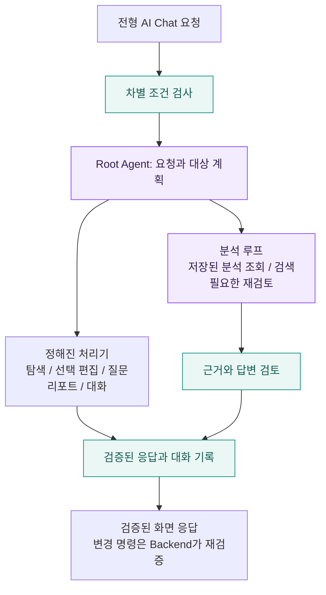
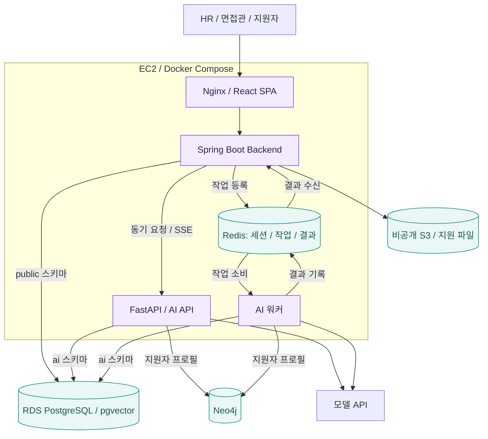

<div align="center">


# HireMate

### 채용의 반복 업무는 AI와 함께, 최종 결정은 담당자가.

공고 작성부터 지원자 분석, 면접 운영, 최종 리포트까지 연결하는<br />
**멀티에이전트 기반 E2E 채용 플랫폼**

<p>
  
  
  
  
</p>

[서비스 소개](#서비스-소개) / [주요 기능](#주요-기능) / [AI 설계](#멀티에이전트-설계) / [아키텍처](#시스템-아키텍처) / [시작하기](#시작하기)

</div>

---

## 서비스 소개

HireMate는 기업이 필요한 전형을 조합하고, 채용 담당자와 면접관이 같은 채용 흐름 안에서 일할 수 있도록 돕는 MVP다.
AI는 자료를 분석하고 후보를 탐색하며 초안을 작성한다. 담당자는 제시된 근거를 확인하고 채용 결정을 내린다.


> **반복적인 서류 검토를 줄이고, 담당자는 근거를 확인해 결정에 집중한다.**
> 합격과 불합격 결정, 전형 결과 확정, 공고 게시, 안내 발송은 담당자가 화면에서 직접 실행한다.

| 기존 업무의 어려움                                  | HireMate의 지원 방식                                      |
| --------------------------------------------------- | --------------------------------------------------------- |
| 지원 문서를 건별로 읽고 필요한 정보를 다시 정리한다 | 서류를 분석해 근거 문장이 포함된 지원자 프로필을 만든다   |
| 조건에 맞는 지원자를 찾기 위해 여러 자료를 오간다   | 전형별 AI Chat으로 후보를 탐색하고 근거와 출처를 확인한다 |
| 평가 결과와 면접 기록을 따로 대조한다               | 지원자별 전형 이력과 분석 결과를 함께 살펴본다            |
| 면접 질문과 안내 문구를 매번 작성한다               | 지원자별 질문과 안내 초안을 생성해 담당자가 검토한다      |

## 채용 흐름

**공고 작성 → 지원 접수 → 기업별 전형 운영 → 결과 확정과 안내 → 최종 리포트**

서류, 평가, 면접 등 필요한 전형을 조합한다. 다음은 서류와 면접을 포함한 운영 예시다.

| 단계        | 담당자가 하는 일                            | AI가 돕는 일                                          |
| ----------- | ------------------------------------------- | ----------------------------------------------------- |
| 공고 준비   | 채용 정보와 전형을 구성하고 공고를 게시한다 | 공고 본문과 포스터 디자인의 초안 및 수정안을 제안한다 |
| 지원 접수   | 제출 자료와 접수 현황을 확인한다            | 제출 문서를 분석하고 지원자 프로필을 갱신한다         |
| 전형 운영   | 기준과 근거를 확인해 지원자를 검토한다      | 후보 탐색, 평가 결과 분석, 확인할 점 정리를 돕는다    |
| 면접 진행   | 면접관을 배정하고 질문과 답변을 기록한다    | 맞춤 질문, 꼬리질문, 답변 분석을 제공한다             |
| 결과와 안내 | 전형 결과를 확정하고 안내를 발송한다        | 안내 문구와 최종 리포트의 초안을 작성한다             |

## 주요 기능

### 01. 공고 작성과 포스터 편집

AI와 대화하며 공고 초안을 작성하고 문구를 수정한다. 포스터 디자인을 제안받고 미리보기에서 검토한 뒤 적용한다.
웹 미리보기와 PDF는 같은 렌더러를 사용하며, Canva와 Templated 연동은 선택해서 설정할 수 있다.

### 02. 근거를 확인하는 지원자 분석

지원 문서, 평가 결과, 면접 답변을 분석해 지원자 정보를 정리한다.
분석 항목에는 근거 문장과 출처를 연결하고, 확인되지 않은 내용은 확인 필요로 남긴다.

### 03. 전형의 맥락을 아는 AI Chat

현재 채용과 전형의 지원자를 대상으로 질문하고 후보를 탐색한다.
선택 지원자 영역 편집과 면접 질문 생성을 요청할 수 있으며, 실제 변경은 Backend가 대상과 권한을 검증해 실행한다.
HR의 Chat 탭은 같은 기업 담당자가 공유하고, 면접관의 탭은 본인만 본다.

### 04. 담당 역할에 맞춘 면접 운영

인사와 실무 면접관을 배정하고 담당 질문, 답변, 꼬리질문과 개인 메모를 관리한다.
면접관은 배정된 지원자의 자료를 확인하고 자기 담당 질문에 답변을 기록한다.
자동 저장과 초안 복구로 기록을 이어가며, 저장 충돌이 생기면 최신 내용과 비교한다.

### 05. 안내 초안과 최종 리포트

담당자가 확정한 결과에 맞춰 안내 초안을 검토하고 발송한다.
전형별 분석과 지원자 비교 자료를 활용한 최종 리포트 초안으로 채용 과정을 돌아본다.

## 멀티에이전트 설계

Root Agent는 요청 종류와 지원자 범위를 계획하고 필요한 처리 경로를 고른다.
미리 정해진 작업은 처리기로 실행하고, 자료를 읽어야 다음 단계를 알 수 있는 요청은 분석 루프가 맡는다.
공고 작성과 포스터 대화는 공고 Agent가 직접 처리한다.



| Agent          | 책임                                                              |
| -------------- | ----------------------------------------------------------------- |
| Root           | 요청 계획, 대상 범위 해석, 탐색과 분석 조합, 근거 검토, 대화 기억 |
| 서류 분석      | 제출 문서 분석과 근거 확인, 지원자 프로필 갱신                    |
| 평가 분석      | 평가 결과와 제출물 분석                                           |
| 면접 분석      | 면접 답변 분석과 확인할 점 정리                                   |
| 공고 생성      | 공고 초안과 수정안, 포스터 디자인 제안                            |
| 면접 질문 생성 | 지원자 자료와 확인할 점에 맞춘 질문 생성                          |
| 안내 생성      | 담당자가 검토할 안내 초안 작성                                    |
| 리포트 생성    | 전형 결과와 지원자 비교를 활용한 리포트 초안 작성                 |

분석과 생성 Agent는 Python 함수로 기능을 공개한다. AI 서버 안에서 Agent끼리 HTTP로 호출하지 않는다.
자료가 들어올 때 워커가 미리 분석하고, Root는 저장된 분석을 읽어 조합한다.
분석이 없거나 재검토가 필요한 경우에만 하위 Agent를 다시 호출한다.

## 신뢰할 수 있는 AI 설계

| 원칙                              | 구현 방식                                                                          |
| --------------------------------- | ---------------------------------------------------------------------------------- |
| **담당자가 결정한다**             | AI에 합격과 불합격 결정, 결과 확정, 게시, 발송 도구를 제공하지 않는다              |
| **근거를 확인한다**               | 분석 근거가 원문에 있는지 확인하고, Root는 근거 번호를 인용해 출처를 연결한다      |
| **과장된 답을 낮추거나 제외한다** | 주장과 근거를 검토하고 확인이 부족한 항목은 확인 필요로 표시한다                   |
| **조회 범위를 제한한다**          | 현재 기업, 채용, 전형을 코드가 지정하고 면접관은 배정된 지원자만 조회한다          |
| **제출 자료와 지시를 구분한다**   | 문서와 URL 본문은 신뢰하지 않는 자료 블록으로 감싸며 도구 권한을 바꾸지 못한다     |
| **차별 조건을 차단한다**          | 나이, 성별, 출신 지역, 혼인 여부, 신체 조건을 이용한 탐색과 필터링 요청을 차단한다 |
| **검증 후 스트리밍한다**          | 화면에는 정해진 단계 문구와 검증을 마친 항목만 먼저 보낸다                         |

NCS는 담당자의 판단을 돕는 참고자료로 사용한다. 참고한 경우 검증된 출처를 별도로 보여주며,
NCS의 직무 설명을 지원자가 실제로 수행한 사실처럼 취급하지 않는다.

## 시스템 아키텍처

운영 환경에서 외부 요청은 Nginx로 들어온다. Backend는 업무 데이터와 권한, 상태 변경을 담당하고,
AI API는 화면에서 기다리는 요청을 처리한다. 시간이 걸리는 분석과 리포트 작업은 Redis 대기열로 워커에 맡긴다.



- **업무 데이터의 쓰기 주체는 Backend**다. AI는 지원자 프로필, 분석 결과, 호출 로그와 Chat 대화를 `ai` 스키마에 저장한다.
- **비동기 작업은 Redis Streams**로 전달한다. 워커는 결과 스트림에 응답하고 Backend가 결과를 반영한다.
- **지원 파일은 비공개 S3**에 보관하고 서명 URL로 접근한다. 로컬 개발에서는 로컬 파일 저장소를 사용한다.
- **DB 마이그레이션은 스키마별로 분리**한다. Backend의 `public` 스키마는 Flyway, AI의 `ai` 스키마는 Alembic으로 관리한다.

## 기술 스택과 저장소

| 영역                 | 주요 기술                                                      | 선택한 역할                                 |
| -------------------- | -------------------------------------------------------------- | ------------------------------------------- |
| Frontend             | React 19, TypeScript, Vite, Tailwind CSS, shadcn/ui            | HR 콘솔, 면접관 모드, 지원자 채용 페이지    |
| 클라이언트 상태와 폼 | TanStack Query, Zustand, React Hook Form, Zod                  | 서버 상태, 클라이언트 상태, 입력 검증       |
| Backend              | Java 25, Spring Boot 4, Spring Security, Spring Modulith, JPA  | 업무 API, 인증과 권한, 모듈 경계            |
| AI                   | Python 3.13, FastAPI, LangGraph, LangChain                     | 요청 계획, 분석과 생성, SSE 응답            |
| 데이터               | PostgreSQL 17, pgvector, Neo4j 5, Redis 8, S3                  | 업무 데이터, 벡터 검색, 지원자 프로필 그래프, 세션과 대기열, 파일 |
| 인프라               | Docker Compose, Nginx, GitHub Actions, AWS EC2 / RDS           | 실행 환경과 CI/CD                           |
| 품질                 | Checkstyle, Vitest, ESLint, Ruff, mypy, pytest, Testcontainers | 코드 검사와 자동 테스트                     |

```text
HireMate/
├── frontend/              HR 콘솔, 면접관 모드, 지원자 페이지
│   └── src/
│       ├── app/           라우트와 공통 레이아웃
│       ├── pages/         사용자별 화면
│       ├── features/      업무 기능별 컴포넌트와 훅
│       └── lib/api/       API 클라이언트와 생성된 계약 타입
├── backend/               업무 서버와 권한 검증
│   └── src/main/
│       ├── java/com/hiremate/  업무별 모듈
│       └── resources/db/  Flyway 마이그레이션
├── ai/
│   └── src/hiremate_ai/
│       ├── agents/        Root, 분석, 생성 Agent
│       ├── llm/           공통 모델 클라이언트와 호출 기록
│       ├── db/            AI 스키마와 Alembic 마이그레이션, 지원자 프로필 그래프
│       ├── ncs_search/    NCS 참고 검색과 질의 임베딩
│       └── worker/        비동기 작업 처리
├── contract/              Backend와 AI가 공유하는 JSON 계약 샘플
├── scripts/demo/          가상 지원자를 이용한 데모
├── compose.yaml           로컬 PostgreSQL, Neo4j, Redis, Mailpit
└── compose.production.yaml  운영 서비스 구성
```

## 로컬 Gemma 문서 정제

Ollama에 `ollama pull gemma4:26b-a4b-it-qat`로 모델을 준비한다. 로컬로 서류를 처리할 때
`OLLAMA_NO_CLOUD=1 ollama serve`로 실행하고, AI API와 워커에 같은 `ai/.env` 설정을 사용한다.

```dotenv
LLM_PROFILE=local
LOCAL_LLM_BASE_URL=http://127.0.0.1:11434/v1
LOCAL_LLM_MODEL=gemma4:26b-a4b-it-qat
APPLICATION_BATCH_ENABLED=false
```

- 정제는 `gemma4:26b-a4b-it-qat`의 Ollama `/api/chat`으로 Pydantic JSON 스키마를 그대로 보낸다. 공용 SDK가
  필드를 필수로 바꾸지 않는다. OpenAI 키나 다른 모델로 대체하지 않는다. 이력서 분석은 같은 로컬 프로필의 Gemma 모델을 사용한다.
- 다른 AI 기능의 로컬 모델을 바꾸더라도 Gemma 4 계열만 지정할 수 있고, 정제 모델은 검증한 태그 그대로다.
  AI를 컨테이너 안에서 실행할 때는 접근 가능한 내부 Ollama 주소(`host.docker.internal` 또는 `ollama`)를 사용한다.
- `local`은 대기 중인 OpenRouter 배치도 처리하지 않는다. 기존 배치를 끝낸 뒤 전환한다.
  `openai`와 `custom`의 정제 설정은 그대로다.

정제 흐름(로컬 Gemma)은 다음과 같다. 모델은 조각 번호로 구조만 답하고, 글은 코드가 원문 조각으로 조립한다.

| 단계 | 동작 | 설정 |
|---|---|---|
| 한 번에 묻기 | 조각 JSON이 한도 이하면 서류 전체를 한 번에 묻는다 | `NORMALIZATION_PART_CHARS`(기본 30000자, 약 2만 토큰) |
| 쪽 묶음 | 한도를 넘으면 연속한 쪽을 비슷한 크기로 묶어 차례로 묻는다. 묶음 호출이 실패하면 그 묶음만 쪽마다 다시 묻는다 | 같은 설정 |
| 빠진 구간 재요청 | 모델이 쪽 하나를 통째로 빠뜨렸거나 쪽 안에서 8조각 넘게 이어서 빠뜨리면 그 구간만 원래 번호로 다시 묻는다 | `NORMALIZATION_MAX_CALLS`(기본 24) |
| 조립과 보정 | 빠진 조각은 제자리에 문단으로 되살린다. PDF 좌표, 글자 크기, 선으로 단 순서, 제목 단계, 괄호 소제목, 문항, 칸 표 항목, 쪽 경계 이어짐을 바로잡는다 | 없음 |
| 실패 처리 | 다시 물어도 원문 조각 절반 넘게 빠지거나, 쪽 수 한도를 넘거나, 조립한 글이 원문과 다르면 다시 시도하지 않고 PDF 추출 글을 쓴다 | `NORMALIZATION_MAX_PAGES`(기본 40) |

- 원문 글자는 바꾸지 않는다(공백, 줄바꿈, NFC 차이만 허용). 글이 든 줄은 숨기지 않고, 쪽 번호와 구분선, 떨어진 머리표만
  `artifact`로 둔다.
- 모델 호출 한 번은 `WORKER_LLM_TIMEOUT_SECONDS`(기본 500초) 안에 끝나야 한다. Ollama는 `OLLAMA_CONTEXT_LENGTH=32768`,
  `OLLAMA_NUM_PARALLEL=1`로 띄운다. 쪽 묶음 한도는 이 문맥 길이 안에서 답까지 끝나도록 잡았다.

## AI 추적과 토큰 사용량 (Langfuse)

요청 하나와 워커 작업 하나를 trace로 묶고, LangGraph 노드와 모델/도구 호출을 하위 단계로 기록한다.
모델 응답의 입력/출력 토큰, 모델 이름, 처리 시간과 오류를 확인할 수 있다.
기존 `ai.llm_calls` 업무용 호출 로그는 그대로 유지한다.

### 로컬 자체 호스팅

업무 DB와 별도의 PostgreSQL, ClickHouse, Redis, MinIO를 사용한다. 화면과 미디어 포트는 로컬에만 연다.
다음 구성은 개발용이며 `compose.production.yaml`에 합치지 않는다.

1. 저장소 루트에서 `langfuse.env.example`을 `.env.langfuse`로 복사한다.
2. 빈 값에 서로 다른 난수를 채운다. `openssl rand -hex 32`로 각 값을 생성할 수 있다.
   `LANGFUSE_ENCRYPTION_KEY`는 반드시 64자리 hex다. 이 파일은 Git에서 제외된다.
3. 서버를 실행한다.

   ```bash
   docker compose --env-file .env.langfuse -f compose.langfuse.yaml up -d --wait
   ```

4. `http://localhost:3000`에서 가입하고 프로젝트를 만든 뒤 프로젝트 API 키를 발급한다.
5. `ai/.env`에 `LANGFUSE_BASE_URL`, `LANGFUSE_PUBLIC_KEY`, `LANGFUSE_SECRET_KEY`를 설정하고
   `LANGFUSE_TRACING_ENABLED=true`로 켠다. 기본 주소는 `http://localhost:3000`이다.
   컨테이너에서 AI를 실행한다면 `localhost`가 아닌 그 컨테이너에서 접근 가능한 주소를 지정한다.

API 키는 서버 설치용 비밀번호와 다르다. 추적은 기본적으로 꺼져 있고, 주소가 비어 있다고 클라우드로 전환하지 않는다.
이전 추적 설정의 호환층은 제거했다. 기존 `ai/.env`에 `LANGSMITH_TRACING`, `LANGSMITH_API_KEY`,
`LANGSMITH_PROJECT`가 남아 있으면 삭제해야 한다. 지원하지 않는 dotenv 항목은 시작 시 설정 오류로 알린다.
LangChain의 간접 의존성인 `langsmith` 패키지는 남지만, 추적 기록의 전송 대상은 Langfuse다.

종료할 때는 `docker compose --env-file .env.langfuse -f compose.langfuse.yaml down`을 쓴다.
`down -v`는 추적 기록을 포함한 로컬 저장 볼륨까지 지우므로 초기화할 때만 쓴다.

### 기록 범위와 평가

- 지시문, 지원 문서 본문, 모델 답변과 도구 결과가 저장된다. **가상 자료로 개발/평가할 때만 켠다.**
  자체 호스팅도 개인정보 처리의 면제나 외부 모델 API 전송 방지를 뜻하지 않는다.
- 모델이 usage를 제공하면 토큰을 기록한다. usage가 없는 호출의 사용량은 측정 불가이며 0으로 해석하지 않는다.
- 비용은 Langfuse의 모델 가격표와 매칭되는 모델에 한해 추정한다. 로컬/사용자 정의 모델과 배치 할인은
  프로젝트의 모델 가격 설정을 확인해야 한다. 토큰 확인만으로 실제 청구액까지 검증된 것은 아니다.
- 일반 테스트는 추적 설정이 켜져 있어도 외부로 보내지 않는다. 추적 테스트는 실제 SDK와 메모리 exporter를 사용한다.
  실제 모델 평가(`LLM_EVAL=true`)만 명시적으로 설정한 Langfuse 서버에 기록할 수 있다.
- 이번 연결은 관측용이다. 골든셋 업로드, 규칙 기반 채점, LLM-as-Judge와 로그 샘플링은 별도 작업이다.
- 의존성 `langfuse`는 전송 및 LangChain 연동에, `opentelemetry-sdk`는 다른 추적기와 격리된 provider와
  메모리 기반 검증에 사용한다. LangSmith 과거 기록의 자동 이관은 하지 않는다.
